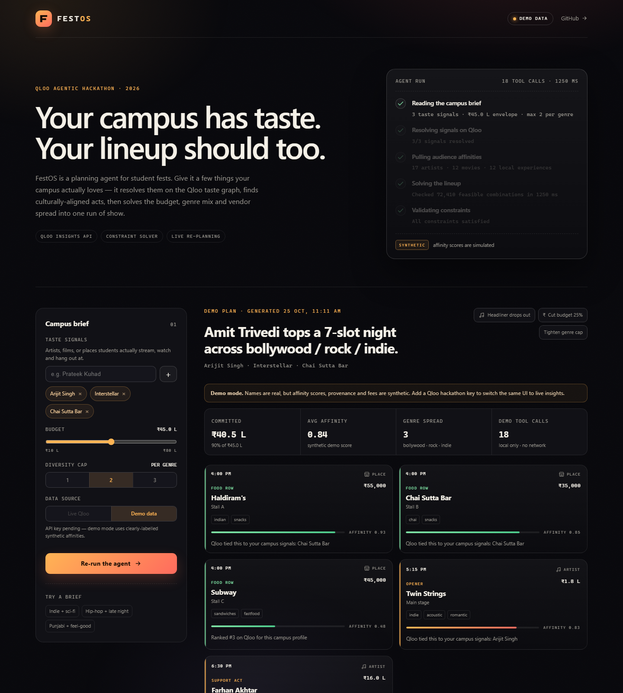

# FestOS

**A taste-aware planning agent for campus fests, built on the Qloo cultural taste graph.**

Give FestOS a handful of things your campus actually loves — an artist, a film, a place students hang out at — and it returns a complete run of show: headliner, support acts, a late-night screening, and a food row, all chosen to fit a real budget and a deliberate genre mix.

Built solo for the [Qloo Agentic Hackathon 2026](https://qloo.devpost.com/).



*One run in demo mode: a Kanpur campus brief resolved into a headliner, support acts, a late-night film and a food row — with the full agent trace open.*

---

## The problem

Campus fest committees plan lineups from last year's list and a WhatsApp poll. The result is predictable: one expensive headliner, three acts that sound the same, a food row nobody visits, and no plan B when the headliner cancels two weeks out.

FestOS treats a lineup as a **cultural-fit problem under constraints**, not a wishlist. Qloo supplies the taste signal; a deterministic solver does the trade-offs; the agent shows every step.

## What one run does

1. **Resolve.** Each taste signal is searched against Qloo's entity graph (`/search`) across artists, movies, and places. Matches below a similarity floor are discarded and reported.
2. **Read taste.** For every resolved signal, FestOS asks Qloo Insights (`/v2/insights`) for affinity-ranked artists, films, and local places near the campus. Candidates are merged and tagged with the signals that surfaced them.
3. **Solve.** A constrained search evaluates hundreds of feasible lineups (3 acts, 1 film, 3 vendors) against budget, a per-genre cap, distinct cuisines, and an affinity floor, then keeps the best-scoring feasible combination.
4. **Validate and explain.** Every constraint is re-checked and printed. Each slot carries a *why* line pointing back to the campus signals that produced it.
5. **Re-plan.** One click simulates a headliner dropping out, a 25% budget cut, or a stricter genre cap. The new plan is diffed against the old one — kept, switched, new, dropped.

## Qloo API usage

| Purpose | Endpoint |
| --- | --- |
| Resolve a signal to an entity | `GET /search?query=…&types=urn:entity:artist` |
| Affinity-ranked candidates | `GET /v2/insights?filter.type=urn:entity:artist&signal.interests.entities=…` |
| Local place candidates | `GET /v2/insights?filter.type=urn:entity:place&filter.address=Kanpur&signal.interests.entities=…` |

Notes:

- Only documented parameters are sent. If a city has no Qloo place coverage, the place lookup retries once without the address filter and the trace says so (`placeScope: broader`).
- Base URL is **`https://hackathon.api.qloo.com`**; the key travels in the `X-Api-Key` header.
- All Qloo traffic happens **server-side**. The browser never sees the key.
- Responses are cached in a private in-memory cache (5 min TTL) — permitted by the hackathon rules — and **no Qloo response data is committed to this repository**.
- If `QLOO_API_KEY` is absent, the app runs in a permanently-labelled **demo mode** with a synthetic catalogue and synthetic affinity scores. The UI banner and the API `meta.mode` both say so.

## Run it

```bash
npm install
cp .env.example .env      # add QLOO_API_KEY=... to go live
npm run dev               # API on :8787, UI on :5173
```

Production build:

```bash
npm run build
npm start                 # serves the built UI and the API on :8787
```

### Demo mode vs live mode

| | Demo | Live |
| --- | --- | --- |
| Seeds resolved locally | ✅ | via Qloo `/search` |
| Affinity scores | synthetic, deterministic | Qloo Insights |
| Fees | synthetic planning weights | modelled from affinity (see below) |
| UI badge | `Demo data` / `SYNTHETIC` | `Live Qloo` / `LIVE` |

The data-source switch is in the left panel. Live mode is disabled until the server has a key.

## How the solver works

`server/planner.js`

- Candidate pools are trimmed to the top 14 artists, 6 films and 9 vendors by affinity.
- Enumerates 3-artist combinations (respecting `maxPerTag` per primary genre), 1 film, and 3 vendors with distinct cuisines — up to ~180k combinations per run, typically in a few tens of milliseconds.
- Scores each feasible lineup:

  ```
  0.50 × average affinity
  + 0.16 × headliner affinity
  + 0.14 × (0.55 × genre spread + 0.45 × cuisine spread)
  + 0.20 × budget fit (targets ~86% envelope use)
  ```

- If the budget cannot support the full shape, it degrades in a logged order: 3 acts + 2 vendors, then 2 acts + 2 vendors, then drops the film. Every degradation is surfaced as a warning.

## Honesty notes

- **Fees are modelled planning weights, not quotes.** Demo entries carry a synthetic fee. Live entries derive a fee from Qloo affinity and a deterministic jitter. The UI labels this everywhere.
- **Demo affinities are synthetic.** The demo catalogue uses real-world names so the flow is legible, but no score or provenance claim in demo mode comes from Qloo.
- **The agent is deterministic.** It is a tool-using planner (resolve → read → solve → validate → re-plan), not an LLM wrapper. Every number in the trace is measured.

## Stack

- Node 20+ / Express API (ESM)
- React 19 + TypeScript + Vite
- No database, no external auth, no client-side API keys

## Repository layout

```
server/
  agent.js      plan orchestration and trace
  qloo.js       Qloo client, normalisation, private cache, demo routing
  planner.js    constrained lineup search, validation, diffing
  demo.js       synthetic catalogue for demo mode
  index.js      Express API + static hosting
src/
  App.tsx       brief, results, trace, re-planning UI
  styles.css    single stylesheet
```

## License

Apache-2.0.
